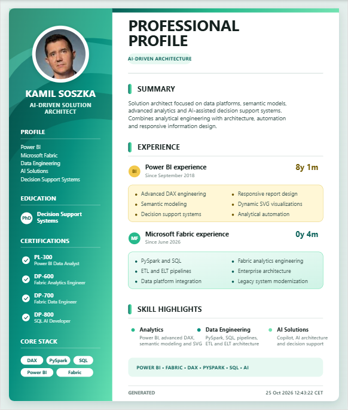
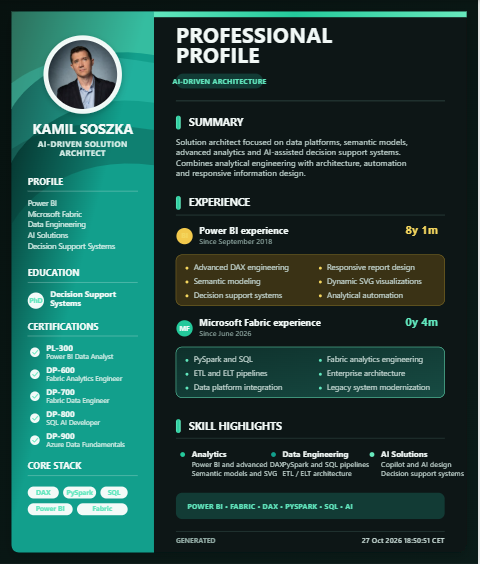
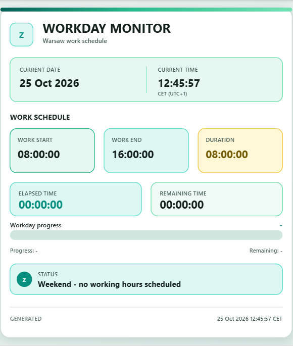
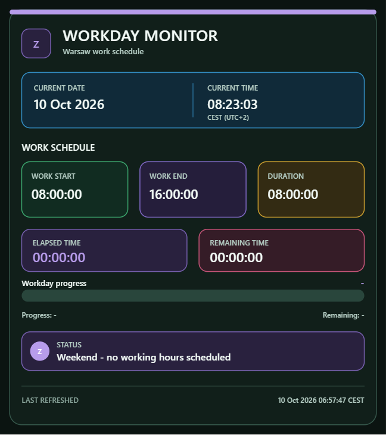

# Power BI Lab

Power BI development and portfolio project featuring advanced DAX, semantic modeling, responsive report design, and dynamic SVG visualizations in coordinated light and dark modes.

## Live Reports

### Professional Profile

Interactive Power BI report presenting professional experience, Microsoft certifications, analytics, data engineering, and AI capabilities.

[Open Professional Profile in Power BI](https://app.powerbi.com/view?r=eyJrIjoiYTJlZWUxYTUtOGQxNS00ODU3LWIxNjktYzIxMDY3ZGIwZWM5IiwidCI6Ijc2NGY3ZmY0LTY2OWQtNDAwYi1iMDY0LTM4NTAyNDAxMTNiYiIsImMiOjl9)

#### Light mode



#### Dark mode



### Workday Monitor

Dynamic workday monitoring report with schedule tracking, elapsed and remaining time, progress calculations, workday status, and Europe/Warsaw CET and CEST handling implemented directly in DAX.

[Open Workday Monitor in Power BI](https://app.powerbi.com/view?r=eyJrIjoiMjU1NjRiMDktZDVkYS00MWU5LWJmZjYtNTRhM2EzNGUzMjJiIiwidCI6Ijc2NGY3ZmY0LTY2OWQtNDAwYi1iMDY0LTM4NTAyNDAxMTNiYiIsImMiOjl9)

#### Light mode



#### Dark mode



## Project Features

- Advanced DAX measures
- Self-contained SVG visualizations returned as Image URL values
- Coordinated light and dark themes inspired by Microsoft Fabric
- Embedded profile photo stored directly in DAX as Base64
- Responsive desktop and mobile report layouts
- Europe/Warsaw CET and CEST handling implemented in DAX
- Dynamic workday progress and status calculations
- Semantic modeling
- Reusable Power BI development components
- Public Power BI report demonstrations
- Power BI Pro workspace and app deployment

## Repository Structure

```text
power-bi-lab/
├── assets/
│   └── images/
│       ├── professional-profile-light.png
│       ├── professional-profile-dark.png
│       ├── workday-monitor-light.png
│       └── workday-monitor-dark.png
├── dax/
│   ├── professional-profile-light.dax
│   ├── professional-profile-dark.dax
│   ├── workday-monitor-light.dax
│   └── workday-monitor-dark.dax
├── power-query/
│   ├── professional-profile.pq
│   ├── refresh-info.pq
│   └── workday-monitor.pq
├── LICENSE
└── README.md
```

## DAX Measures

The `dax` directory contains four complete Power BI measures:

- `professional-profile-light.dax`
- `professional-profile-dark.dax`
- `workday-monitor-light.dax`
- `workday-monitor-dark.dax`

Each measure generates a complete SVG visualization and returns it as a Power BI-compatible data URI.

The current measures are self-contained and do not require the `RefreshInfo` table. The displayed `GENERATED` timestamp represents the DAX measure evaluation time converted to Europe/Warsaw local time. It does not represent semantic model refresh metadata.

## Power Query Scripts

The `power-query` directory contains earlier supporting and reference scripts retained for development history and experimentation:

- `professional-profile.pq`
- `workday-monitor.pq`
- `refresh-info.pq`

These scripts are not required by the current four DAX SVG measures.

## Installation

### 1. Add a DAX measure

1. Open the Power BI Desktop model.
2. Select the table that should store the measure.
3. Select **New measure**.
4. Open the corresponding `.dax` file from the `dax` directory.
5. Copy and paste the complete measure definition.
6. Set **Data category** to **Image URL**.
7. Add the measure to a visual that supports Image URL values.

No Power Query supporting table is required for the current SVG measures.

### 2. Configure the visual

For best results:

- disable the visual title,
- disable the visual background,
- disable the visual border,
- minimize internal padding,
- preserve the intended SVG aspect ratio,
- validate rendering in both Power BI Desktop and Power BI Service.

## Workday Monitor Configuration

The default configuration is:

```text
Work start: 08:00
Work end:   16:00
Time zone:  Europe/Warsaw
Workdays:   Monday to Friday
```

The schedule can be changed in both Workday Monitor measures:

```dax
VAR WorkStartTime = TIME(8, 0, 0)
VAR WorkEndTime = TIME(16, 0, 0)
```

Keep the same values in the light and dark measures to preserve consistent calculations.

## Time-Zone Handling

The measures calculate Europe/Warsaw daylight-saving-time conversion directly in DAX:

```text
CET  = UTC+1
CEST = UTC+2
```

The applicable offset is determined using the final Sunday of March and the final Sunday of October.

## Generated Timestamp

The footer displays `GENERATED` followed by the current Europe/Warsaw date and time calculated from `UTCNOW()`.

```dax
VAR CurrentUtcDateTime = UTCNOW()
```

This value represents measure evaluation time. Pure DAX does not provide a reliable semantic model refresh timestamp without an external metadata source or supporting refresh table.

## Professional Profile

The Professional Profile measures include:

- an embedded circular profile photo,
- professional summary,
- Power BI and Microsoft Fabric experience calculations,
- certifications,
- education,
- analytics, data engineering, and AI capabilities,
- coordinated light and dark palettes,
- a DAX-generated Europe/Warsaw timestamp.

The profile photo is embedded directly in the measure as a Base64 JPEG and does not depend on an external image URL.

## Light and Dark Modes

Both report components are available in coordinated variants:

```text
Professional Profile Light
Professional Profile Dark
Workday Monitor Light
Workday Monitor Dark
```

Each light and dark pair preserves the same:

- layout,
- calculations,
- labels,
- dimensions,
- font hierarchy,
- information structure.

Only the visual color system changes between modes.

## Mobile Layout

Both reports include layouts intended for Power BI mobile experiences. Rendering should be validated separately in:

- Power BI Desktop,
- Power BI Service,
- Power BI mobile applications,
- different browser zoom levels.

## License

This project is licensed under the MIT License. See [LICENSE](LICENSE) for details.
